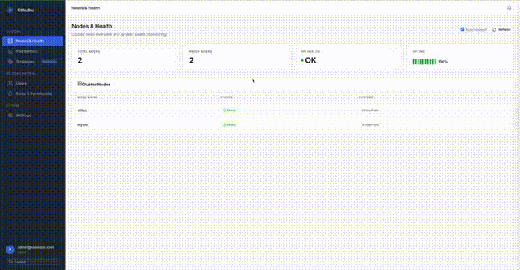

# Gthulhu: From Kubernetes Resource Allocation to Linux Task Scheduling

<a href="https://landscape.cncf.io/?item=provisioning--automation-configuration--gthulhu" target="_blank"></a>
<a href="https://ebpf.io/applications/" target="_blank"></a>

[](https://insights.linuxfoundation.org/project/gthulhu)
[](https://github.com/Gthulhu/Gthulhu/actions/workflows/go.yaml)
[](https://github.com/Gthulhu/Gthulhu/actions/workflows/portability.yaml)
[](https://goreportcard.com/report/github.com/Gthulhu/Gthulhu)


> **DRA chooses what and where; Gthulhu controls how it actually runs.**

Gthulhu is a cloud-native runtime scheduling platform built around Kubernetes, eBPF, and Linux `sched_ext`.

Kubernetes can decide **whether a workload may run**, **which node it runs on**, and increasingly **which GPU, NIC, CPU set, NUMA domain, or other device it receives**. But those allocation decisions do not by themselves guarantee that the workload's critical Linux threads receive the CPU service, locality, responsiveness, or isolation needed to meet an SLO.

Gthulhu focuses on that execution gap.

```text
Kueue / Workload API
  admission, quota, fair sharing
            │
            ▼
kube-scheduler / DRA
  Node + device + topology allocation
            │
            ▼
Gthulhu Runtime Plane
  workload / claim → Pod/cgroup → TGID/TID
            │
            ▼
sched_ext + eBPF
  runtime policy + verification
            │
            ▼
Delivered workload SLO
  latency / throughput / jitter / utilization
```

The long-term direction is **Claim2Core**: connect actual Kubernetes allocation to Linux task scheduling without reimplementing kube-scheduler, DRA, or Kueue. See the [2026 Claim2Core roadmap](https://github.com/Gthulhu/Gthulhu/issues/141).



> Demo video: https://youtu.be/Cyjrh9cW1a8

## What Gthulhu Does Today

### Scheduling observability

Gthulhu uses eBPF to collect scheduler behavior at process/task level and aggregate it into Kubernetes-aware metrics, including:

- CPU runtime and scheduler wait time;
- voluntary / involuntary context switches;
- run count and scheduling frequency;
- CPU migrations;
- workload-level scheduling pressure.

These metrics can be exported to Prometheus/Grafana and used by KEDA for autoscaling.

### Distributed scheduling intent

A central **Manager** resolves workload-level policy and distributes intent to a per-node **Decision Maker**. Each Decision Maker resolves local processes/tasks and exposes node-local strategies to the Gthulhu daemon.

### Custom CPU scheduling with `sched_ext`

On Linux 6.12+ with `sched_ext`, Gthulhu can apply workload-aware CPU scheduling policy without patching the kernel.

Current policy primitives include:

- priority treatment;
- custom time slices;
- CPU locality / affinity hints;
- preemption-oriented behavior where supported by the scheduler path.

### TID-aware node policies

Linux schedules tasks/threads, not only process leaders. Node policies therefore scan `/proc/<tgid>/task/<tid>` and can match non-leader worker threads by `comm`.

This matters for workloads where the critical work happens in named worker threads, such as:

- LLM engine/decode workers;
- NCCL/RDMA progress threads;
- DPDK or packet-processing workers;
- host-side helper threads.

A node policy resolved to a worker thread is keyed by **TID**, so the scheduler can target the entity Linux actually dispatches.

### Priority semantics across scheduler modes

A strategy with `Priority > 0` is a boost. `Priority == 0` is non-boosting.

- In **user-space mode**, a TID-specific strategy is preferred, with TGID fallback for group-wide Pod policy behavior. A slice-only rule can still carry a custom time slice without jumping the queue.
- In **kernel mode**, non-boosting strategies are not inserted into the priority BPF map. This avoids interpreting priority `0` as the highest preemptive level. Kernel mode does not yet provide full slice-only parity with user-space mode.

These semantics reflect the merged TID-aware scheduler work in the main repository and `Gthulhu/plugin`.

## Claim2Core Direction

The next architecture step is not "use ResourceSlice as another selector". The intended boundary is:

- `ResourceSlice` = device **inventory**;
- `ResourceClaim.status.allocation` = workload's **actual allocation**;
- Gthulhu = runtime execution plane after allocation.

The target lineage is:

```text
Workload / PodGroup UID
  → Pod UID
  → ResourceClaim UID + generation
  → allocated driver / pool / device
  → NUMA / PCIe / network topology
  → Pod cgroup
  → TGID / TID / starttime
  → sched_ext DSQ / BPF-map entry
  → observed runtime metrics
  → workload SLO
```

Near-term implementation order:

1. correct DRA / ResourceSlice semantics;
2. add a read-only ResourceClaim observer;
3. add Claim-to-Task preview / provenance;
4. introduce a bounded static `DRAExecutionPolicy`;
5. validate one workload adapter (free5GC/UPF or LLM serving);
6. add closed-loop runtime control only after static policy and provenance are trustworthy.

### Hard boundaries

Gthulhu is **not a GPU scheduler**. `sched_ext` schedules Linux CPU tasks; Gthulhu does not directly schedule CUDA kernels, GPU SMs, MIG, or NIC hardware queues.

Gthulhu can improve host-side execution for GPU feeder/launch threads, tokenizers, NCCL/RDMA progress threads, DPDK pollers, packet-processing workers, data loaders, checkpoint workers, and similar tasks.

CPU DRA, cgroups, kubelet, and other resource managers remain authoritative for the CPU/resource envelope. Gthulhu must optimize **inside** that envelope, never outside it.

## Architecture

```text
┌────────────────────────────────────────────────────────────────────┐
│                         Gthulhu Control Plane                       │
│                                                                    │
│  User / Web UI / CRD ──▶ Manager ──▶ MongoDB / Kubernetes API     │
└──────────────────────────────┬─────────────────────────────────────┘
                               │ scheduling intent / runtime config
                  ┌────────────┴────────────┐
                  ▼                         ▼
         Decision Maker              Decision Maker
            (Node 1)                    (Node N)
             │   │                        │   │
             │   ├── eBPF metrics        │   ├── eBPF metrics
             │   └── task resolution     │   └── task resolution
             ▼                            ▼
        Gthulhu daemon               Gthulhu daemon
             │                            │
             └──────▶ sched_ext / BPF ◀───┘
                         │
                         ▼
                   Linux scheduler
```

## Prerequisites

### Metrics / monitoring

- Go 1.22+
- LLVM/Clang 17+
- libbpf
- Linux kernel with eBPF/BTF support

### Custom CPU scheduling

- Linux 6.12+ with `sched_ext` / `CONFIG_SCHED_CLASS_EXT`

The eBPF monitor does not require `sched_ext`. Custom CPU scheduling does.

See the [installation guide](https://gthulhu.org/installation/) for deployment details.

## Build

```bash
make dep
git submodule init
git submodule sync
git submodule update
cd scx
cargo build --release -p scx_rustland
cd ..
make build
```

Cross-build for arm64:

```bash
make build ARCH=arm64
```

Lint:

```bash
make lint
```

## Test

```bash
make test
```

Or select a kernel version:

```bash
make test KERNEL_VERSION=6.12
```

Gthulhu runs daily portability tests across supported Linux 6.12+ kernels.

## Run with schedkit

Install `schedctl` from [schedkit](https://github.com/schedkit/schedctl), then run:

```bash
sudo schedctl run gthulhu
```

## Run with Docker

```bash
docker run --privileged=true --pid host --rm ghcr.io/gthulhu/gthulhu:latest /gthulhu/main
```

## Debugging

See [Scheduler optimization notes](./SCHEDULER-OPTIMIZATION.md) for the cgo
hot-path design, adaptive-priority investigation, measured results, and
reproduction commands.

### Adaptive wakeups (default in user-space scheduling)

Application wakeup preemption is enabled by default in user-space scheduling;
the former `-adaptive-wakeup` flag has been removed. Kernel mode is unchanged.
Every task still goes through Go. A wakeup qualifies only if its known previous
full runnable burst and its final execution segment are both positive and at
most 1 ms. BPF reports the previous full burst through
`exec_runtime` on wakeups, rather than the newly reset current burst. Reenqueues
retain current-burst runtime reporting.

Go reduces a qualifying task's dispatch deadline by one default slice, flooring
nonzero deadlines at 1 and preserving explicit priority 0. This adjustment occurs
after selection from the plugin heap; it does not change the heap's ordering.
BPF only preempts an ordinary task still running on the selected CPU if its
deadline is later. Scheduler-process threads remain protected. There is no
minimum-current-runtime gate: rejecting a one-shot request on that basis had no
retry and could delay an eligible wakeup until a later scheduling event.
Single-CPU tasks retain their allowed CPU when idle selection returns ANY; all
dispatches still undergo affinity validation.

The scheduling loop uses direct, nonblocking ringbuffer
consumption instead of a polling goroutine and channel handoff. Completed Go
dispatches are drained by BPF before scheduling additional policy work. Once the
Go pool is empty, the loop uses Linux `sched_yield` to hand the CPU back to the
BPF dispatcher; it does not spin while holding a Go P or block inside
`asmcgocall`. The BPF fallback/scheduler slice uses `scheduler.slice_ns_min`
in this mode, while `slice_ns_default` remains the Go fairness/deadline budget.
Kernel mode retains its existing queue and slice behavior.

Before becoming the default, with both experimental flags, `builtin_idle: false`, and diagnostics
disabled, three repeated `schtest --filter adaptive_priority` runs measured final
nonzero ratios **0.24, 0.22, and 0.21**, below the required 0.50. Each run also
measured a sub-0.50 ratio in its >=5-second batch; this is not based solely on the
test runner's zero-valued convergence return. These are host-specific results,
not a latency guarantee. Validate fairness and
throughput on the target workload.

Repeating with the repository's monitor-enabled configuration measured 0.21,
0.22, and 0.22. The `fairness` test also passed with the experiment enabled
(0.98) and disabled (0.96).

After making adaptive wakeups the default, three monitor-enabled runs with
**neither** experimental flag measured final nonzero ratios 0.22, 0.19, and 0.21;
their >=5-second batches also remained below 0.50. Default-mode `fairness` passed
at 0.98. `-usersched-preempt` is not required for these results.

```bash
sudo ./main scheduler -config config/config.yaml
sudo schtest/target/debug/schtest --filter adaptive_priority
```

### Experimental scheduler-loop wakeup preemption

```bash
sudo ./main scheduler -config config/config.yaml -usersched-preempt -trace-scheduler-cpu
```

`-usersched-preempt` is off by default and only applies to the user-space
scheduler. The pinned loop registers its Linux TID after attachment and clears
it on exit. When that thread wakes with pending work and no idle CPU is found,
BPF can head-insert it on its assigned, affinity-allowed CPU and request
preemption, globally limited to once per millisecond. Other scheduler-process
threads and slice-expiry reenqueues retain the existing policy; throttled
wakeups fall back to SCHED_DSQ. The idle-CPU path is unchanged. This is not a
latency guarantee: higher scheduling classes and runtime waits can still delay
the loop. The early startup window before TID registration also uses the old
policy.

Compare runs with/without this flag under the same workload and diagnostic
settings. Measure kernel runnable-to-running delay, slow-call frequency, and
application throughput/latency; a lower scheduler delay alone is not a win if
application performance regresses. CPU-time tracing itself adds overhead.

```bash
sudo bpftool prog list
sudo bpftool map list
sudo cat /sys/kernel/debug/tracing/trace_pipe
```

To diagnose user-space scheduling stalls without changing the cgo bridge:

```bash
sudo ./main scheduler -config config/config.yaml -trace-scheduler-loop
```

This opt-in diagnostic reports each call's cumulative count, average, maximum,
and count taking at least 1 ms every second, plus the active call and its elapsed
time. `p50_le`, `p99_le`, and `p999_le` are cumulative histogram percentile
upper bounds (power-of-two nanosecond buckets), not exact percentiles.
Like `max`, they cover the entire run, not just the previous second.
It adds timing/atomic overhead; leave it off for performance comparisons.
Durations include time descheduled, GC pauses, and lock waits, not just CPU time.
`BlockTilReadyForDequeue` can legitimately wait while idle; a long wait alone
does not prove a deadlock. Correlate it with queued work and a goroutine dump
(pprof is available on port 6060 when `debug: true`).
The reporter is a Go goroutine: missing reports can indicate runtime or system
starvation and cannot identify the blocked call by themselves. This diagnostic
does not measure BPF dispatch latency or replace kernel tracing.

For SelectCPU CPU-time attribution, enable the more intrusive diagnostic:

```bash
sudo ./main scheduler -config config/config.yaml -trace-scheduler-cpu
```

This implies loop tracing and adds two `CLOCK_THREAD_CPUTIME_ID` clock syscalls
per selection. The startup log includes the pinned loop's Linux `tid`.
`SelectCPU_thread` reports average thread CPU time and a paired sample for the
largest wall-time measurement: `worst_wall`, `worst_cpu`, and
`worst_non_cpu_estimate`. A large wall time with small CPU time points toward
descheduling or blocking, not CPU-intensive selection. The difference is an
estimate because the wall/CPU clock boundaries differ and include diagnostic
overhead. CPU time includes user and kernel execution on this thread; it does
not isolate BPF execution or distinguish GC, lock waits, and OS scheduling.
Only the slowest sample is retained; there is no per-call logging.

To correlate GC/runtime scheduling, set `debug: true` and capture a short trace
from the local pprof endpoint while reproducing the workload:

```bash
curl --fail 'http://127.0.0.1:6060/debug/pprof/trace?seconds=10' -o /tmp/gthulhu-runtime.trace
go tool trace /tmp/gthulhu-runtime.trace
```

For kernel scheduling evidence, substitute the logged numeric TID below:

```bash
sudo perf sched record -t <tid> -- sleep 10
sudo perf sched timehist -t <tid>
```

Runtime tracing does not fully describe syscalls made via bare `asmcgocall`;
use kernel scheduling evidence to verify off-CPU attribution. These captures
add overhead and should be short; neither is enabled by default.

After changing BPF callbacks, rebuild with `make build`. The wrapper includes
`qumun/main.skeleton.h`, so the root build generates the skeleton there (not in
the repository root) and forces a Go rebuild to avoid cached external C
archive/header contents. A successful Go link alone does not establish that
the updated BPF program was embedded.

Queued tasks must be counted before `bpf_ringbuf_submit` publishes them. The
current plugin checks `nr_queued` after dequeuing a record; publishing first
can make it consume and discard a task while the counter is still zero,
leaving a stranded count after the producer increments it.
`TestQueuePublicationOrder` reproduces this interleaving with the actual plugin
without requiring BPF privileges.

The qumun test
`TestBlockTilReadyForDequeueRequeueBlocksWithWaitingProducer` reproduces the
current channel requeue deadlock without loading BPF: a waiting producer fills
the slot released by the receive, so requeueing blocks even after cancellation.
It is a diagnostic reproduction, not a fix or proof that a particular watchdog
exit was caused by this path.

## Related repositories

- [qumun](https://github.com/Gthulhu/qumun) — Go framework for building custom Linux schedulers with eBPF / `sched_ext`.
- [plugin](https://github.com/Gthulhu/plugin) — user-space scheduling strategy implementation.
- [docs](https://github.com/Gthulhu/docs) — official documentation published at [gthulhu.org](https://gthulhu.org/).
- [gtp5g-operator](https://github.com/Gthulhu/gtp5g-operator) — telecom / GTP5G integration work.

## Research / workload directions

Two immediate validation paths are especially useful:

- **CPU DRA × Gthulhu × free5GC/UPF** — fastest path to a credible end-to-end runtime scheduling demo with p99/p99.9 latency and jitter.
- **GPU + RDMA + CPU DRA × phase-aware LLM scheduling** — higher research upside around TTFT, ITL, GPU idle gaps, and NCCL/RDMA progress.

Longer term, Gthulhu is also exploring device-local execution domains, scheduling provenance/replay, shared-device interference control, device-health-aware degradation, and cooperative resource reclamation.

## Meaning of the Name

The name Gthulhu is inspired by Cthulhu and Golang. The many tentacles represent coordinating complex distributed runtime behavior.

The underlying framework **qumun** is named after the Bunun word for "heart", reflecting the scheduler's role at the heart of the operating system.

## Contributing

See [CONTRIBUTING.md](CONTRIBUTING.md) and the [official contribution guide](https://gthulhu.org/contributing/).

Useful contributor areas include Kubernetes/DRA, eBPF, `sched_ext`, NUMA/topology, scheduling provenance, testing, free5GC/UPF, and accelerator workloads.

## Community

- [2026 Claim2Core roadmap](https://github.com/Gthulhu/Gthulhu/issues/141)
- [GitHub Discussions](https://github.com/Gthulhu/Gthulhu/discussions)
- [Official documentation](https://gthulhu.org/)
- [LFX project insights](https://insights.linuxfoundation.org/project/gthulhu)

## License

Apache License 2.0.

## Special Thanks

- [sched-ext/scx](https://github.com/sched-ext/scx)
- [libbpfgo](https://github.com/aquasecurity/libbpfgo)
